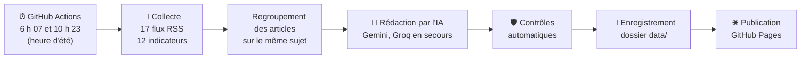

# Morning-Market

Tableau de bord économique quotidien : l'essentiel de l'actualité économique en cinq minutes, et la mémoire de l'année pour réviser.

👉 **Site : https://gaaabbb444.github.io/Morning-Market/**

Ce guide explique comment l'outil fonctionne, comment relancer une mise à jour à la main et quoi faire si quelque chose casse. Il n'y a jamais besoin de modifier du code pour suivre ces étapes. Le brief complet du projet est dans [CAHIER_DES_CHARGES.md](CAHIER_DES_CHARGES.md). La page [Méthodologie](https://gaaabbb444.github.io/Morning-Market/#/methodologie) du site présente la même chose à un lecteur extérieur, comme un jury.

---

## 1. Comment ça marche

Tout est automatique et gratuit. Un programme tourne deux fois par jour sur les serveurs de GitHub. Il prépare l'édition du jour, l'enregistre dans le dépôt, puis publie le site.



1. **Collecte.** Le programme lit les flux RSS des médias (Le Monde, Les Echos, BFM Business, la BCE…) et récupère les indicateurs : CAC 40, inflation, chômage, taux… Il garde les articles des 30 dernières heures et écarte ceux déjà parus dans l'édition précédente.
2. **Regroupement.** Quand plusieurs médias parlent du même événement, leurs articles sont réunis en une seule info, avec le nombre de sources.
3. **Rédaction par l'IA.** L'IA classe les infos par catégorie et par importance. Elle rédige ensuite « L'essentiel », le Top 5 (faits, analyse, « Pour tes copies »), le concept du jour, la citation du jour, l'évolution des fils rouges, le récap de la semaine (le dimanche, dès que la semaine compte au moins 3 éditions) et celui du mois (le 1er).
4. **Contrôles.** Avant d'enregistrer quoi que ce soit, le programme vérifie le travail de l'IA :
   - aucun chiffre absent de l'article ;
   - citation présente mot pour mot dans l'article ;
   - notion choisie dans le glossaire ;
   - règle des sources sans chapeau.

   Ce qui échoue est écarté. Les données déjà publiées ne sont **jamais** remplacées par des données vides ou invalides.
5. **Enregistrement.** Les résultats sont des fichiers JSON dans le dossier `data/`. GitHub les enregistre automatiquement (commits « Données du … » signés github-actions).
6. **Publication.** Le site est mis en ligne sur GitHub Pages. Le site lui-même n'utilise aucune IA : il se contente de lire les fichiers déjà préparés.

**Les deux passages de la journée**

| Passage | Heure de Paris (été / hiver) | Rôle |
|---|---|---|
| Matin | 6 h 07 / 5 h 07 | Crée l'édition du jour. |
| Fin de matinée | 10 h 23 / 9 h 23 | Complète l'édition. Une info du Top 5 n'est remplacée que par un événement nettement plus important. |

Les serveurs de GitHub fonctionnent à l'heure universelle, d'où le décalage d'une heure en hiver. GitHub peut aussi lancer avec quelques minutes de retard.

**Si l'IA ne répond pas**, le programme essaie le modèle suivant : Gemini 3.8 Flash, puis gpt-oss-120b chez Groq, puis Gemini 3.5 Flash-Lite. Si aucun ne répond, le site passe en **mode simplifié** : titres et liens seulement, classés par mots-clés, avec un bandeau qui le signale.

---

## 2. Ce que contient le dépôt

| Dossier ou fichier | Ce qu'on y trouve |
|---|---|
| `site/` | Le site lui-même (pages, mise en forme, police). |
| `data/` | **La mémoire du site** : une édition par jour (`jours/`), les indicateurs, les fils rouges, les récaps, le glossaire (`concepts.json`), les citations, l'état de la dernière mise à jour (`statut.json`). |
| `collecte/` | Le programme qui prépare l'édition (collecte, IA, contrôles, mémoire). |
| `config/config.yaml` | Les réglages : catégories, médias suivis, indicateurs, modèles d'IA. |
| `config/prompts/` | Les consignes données à l'IA (neutralité politique, pas de chiffre inventé…). |
| `contrat/` | La description de chaque fichier de `data/`, avec un exemple. |
| `tests/` | Les tests automatiques qui vérifient les garde-fous. |
| `outils/` | Les outils de vérification du site (captures, interactions, accessibilité). |
| `.github/workflows/mise-a-jour.yml` | Le planning et les étapes de la mise à jour automatique. |
| `Maquette/` | La maquette validée du design. |

Ce qui n'est **jamais** publié :
- les clés d'IA, rangées dans les secrets de GitHub et, sur ton ordinateur, dans le fichier `.env` ;
- les chapeaux des articles (fichiers `tmp/`), par respect du droit de la presse. Le dépôt ne garde que le titre, la source, la date, le lien et le résumé rédigé par l'IA.

---

## 3. Au quotidien : rien à faire

Le site se met à jour seul. Pour vérifier que tout va bien :

1. Ouvre le site : en haut de l'accueil, la date du jour et « mis à jour à … » doivent apparaître.
2. Ou ouvre l'onglet **Actions** du dépôt (https://github.com/Gaaabbb444/Morning-Market/actions) : chaque exécution de « Mise à jour et publication » doit avoir une coche verte ✅.

---

## 4. Relancer une mise à jour à la main

Utile si une mise à jour a échoué, ou pour avoir une édition plus récente.

**Depuis le site de GitHub (le plus simple)**
1. Va sur https://github.com/Gaaabbb444/Morning-Market/actions (connecté à ton compte).
2. Dans la colonne de gauche, clique sur **Mise à jour et publication**.
3. À droite, clique sur le bouton **Run workflow**.
4. Laisse la case « Reconstruire l'édition du jour depuis zéro » **décochée**, sauf si l'édition du jour est vraiment ratée : cochée, elle repart de zéro au lieu de compléter.
5. Clique sur le bouton vert **Run workflow**.
6. Attends 3 à 5 minutes : une nouvelle ligne apparaît, d'abord jaune (en cours), puis verte (réussie).
7. Recharge le site.

**Depuis le terminal** (si l'outil `gh` est installé et connecté) :
```bash
gh workflow run mise-a-jour.yml
```
puis, pour suivre l'avancement :
```bash
gh run list --limit 3
```

**Bon à savoir**
- Si l'édition du jour n'a été créée que par une mise à jour manuelle (par exemple en pleine nuit), le passage du matin la refait proprement.
- Les infos de l'édition de la veille ne sont jamais republiées.
- Une mise à jour ne modifie jamais les jours passés.

---

## 5. Si quelque chose casse

Le site est conçu pour **ne jamais casser** : en cas de panne, il continue d'afficher les dernières données valides et signale le problème par un bandeau. Voici les situations possibles, de la plus courante à la plus rare.

### Le site affiche « Données du JJ/MM : la mise à jour de ce matin n'a pas abouti »
La mise à jour du matin a échoué ou n'a pas encore tourné (ce bandeau apparaît après 7 h 30).
1. Ouvre l'onglet **Actions** et regarde la dernière exécution.
2. Si elle est en cours (jaune), attends qu'elle se termine.
3. Si elle a échoué (croix rouge ❌), clique dessus pour voir l'étape en rouge, puis relance une mise à jour à la main (partie 4).
4. Si elle échoue encore, demande à Claude d'analyser l'exécution. Donne-lui le lien de la page de l'exécution.

### Le site affiche « Résumés momentanément indisponibles : seuls les titres et les sources sont affichés »
L'IA n'a pas répondu (mode simplifié). Causes possibles :
- **Quota gratuit dépassé ou service en panne.** C'est temporaire : la mise à jour suivante repasse en mode normal.
- **Clé expirée ou supprimée.** Si le bandeau reste plusieurs jours, il faut créer une nouvelle clé :
  1. Pour Gemini, va sur https://aistudio.google.com/apikey. Pour Groq, va sur https://console.groq.com/keys.
  2. Crée une nouvelle clé et copie-la.
  3. Sur GitHub, ouvre le dépôt, puis **Settings** → **Secrets and variables** → **Actions**.
  4. Clique sur le crayon à côté de `GEMINI_API_KEY` (ou `GROQ_API_KEY`), colle la nouvelle clé, puis clique sur **Update secret**.
  5. Relance une mise à jour à la main (partie 4).

  Ne colle jamais une clé dans une conversation, dans un fichier du dépôt ou dans un message : seulement dans les secrets de GitHub (et dans le fichier `.env` de ton ordinateur).

### Un indicateur affiche « — » ou « Indisponible »
Sa source n'a pas répondu, par exemple Yahoo Finance pour les cours de bourse. La dernière valeur connue reste utilisée tant qu'elle existe. En général, tout rentre dans l'ordre au passage suivant. Si ça dure plusieurs jours, demande à Claude de vérifier la source.

### Les mises à jour planifiées se sont arrêtées
GitHub met en veille les tâches planifiées des dépôts publics inactifs depuis 60 jours. Le programme se réactive lui-même à chaque passage, mais si ça arrive quand même :
1. Ouvre l'onglet **Actions**.
2. Clique sur **Mise à jour et publication**.
3. Clique sur le bouton **Enable workflow** s'il apparaît.

### GitHub annonce le retrait d'Ubuntu 24.04
Le programme tourne sur une version figée d'Ubuntu (24.04), pour éviter qu'un changement de version décidé par GitHub (Ubuntu 26 à partir du 19 octobre 2026) le casse sans prévenir. **Il faudra passer à une version plus récente avant que GitHub ne retire Ubuntu 24.04.** GitHub annonce ces retraits plusieurs mois à l'avance sur https://github.com/actions/runner-images et par des avertissements jaunes dans les exécutions. Quand c'est annoncé, demande à Claude de faire la mise à jour : il remplace `ubuntu-24.04` aux deux endroits du fichier `.github/workflows/mise-a-jour.yml`, lance une exécution manuelle et vérifie qu'elle réussit.

### Un média ne remonte plus d'articles
Ce n'est pas grave pour le site : les autres médias suffisent. Le détail est dans `data/statut.json` (partie 6). Si un média reste en erreur plusieurs jours, son flux RSS a sans doute changé d'adresse : demande à Claude de le vérifier depuis une exécution en ligne. Les serveurs de GitHub sont aux États-Unis, et certains sites y répondent différemment.

### Le site est totalement vide ou affiche « Données momentanément indisponibles »
La publication elle-même a échoué. Relance une mise à jour à la main : la publication est refaite à la fin. Si ça persiste, demande à Claude.

---

## 6. Lire l'état de la dernière mise à jour

Le fichier [`data/statut.json`](data/statut.json) est le carnet de bord de la dernière exécution. On peut l'ouvrir directement sur GitHub.

| Partie | Ce qu'elle indique |
|---|---|
| `derniere_execution` | Début, fin, type (matin, fin de matinée, manuel) et résultat (`ok`, `partiel` ou `echec`). |
| `sources` | Pour chaque média : `ok` ou `erreur`, nombre d'articles, dernier succès. |
| `indicateurs` | Pour chaque indicateur : à jour, ou dernière valeur conservée. |
| `ia` | Nombre de requêtes à l'IA, modèles utilisés, erreurs éventuelles, et pour chaque étape si elle a été faite par l'IA ou en mode simplifié. |
| `ecritures` | Les fichiers enregistrés et, sinon, la raison du refus (ex. réponse de l'IA invalide : version précédente conservée). |

---

## 7. Tâches éditoriales de temps en temps

- **Relire les concepts du glossaire** : par lots de 10, en commençant par ceux déjà utilisés dans « Pour tes copies ». Chaque concept relu est marqué `relu: true` dans `data/concepts.json`. Il suffit de dire à Claude lesquels sont validés ou à corriger.
- **Vérifier les citations d'économistes** : elles ne s'affichent qu'une fois vérifiées à la main dans leur source d'origine (livre, article, discours). Dis à Claude lesquelles tu as vérifiées et il les marquera `verifiee: true`.
- **Ajouter un fil rouge ou un média** : demande à Claude. Il met à jour `config/config.yaml` et vérifie que la nouvelle source fonctionne depuis les serveurs de GitHub.

---

## 8. Pour travailler sur le projet depuis l'ordinateur

Ces commandes servent surtout à Claude. Elles se lancent dans le dossier du projet, sous Windows.

**Installation (une seule fois)**
```bash
python -m venv .venv
```
```bash
.venv\Scripts\python -m pip install -r requirements-dev.txt
```
```bash
.venv\Scripts\python -m playwright install chromium
```
L'outil Tailwind (mise en forme) se télécharge dans `outils/` : il n'est pas enregistré dans le dépôt. Les clés d'IA locales vont dans un fichier `.env`, jamais publié.

**Lancer une mise à jour sur l'ordinateur** (sans clé : mode simplifié)
```bash
.venv\Scripts\python -m collecte.principal
```

**Voir le site en local** (http://localhost:8000)
```bash
.venv\Scripts\python outils\apercu.py
```

**Vérifications avant chaque mise en ligne**
```bash
.venv\Scripts\python -m pytest -q
```
```bash
.venv\Scripts\python outils\verifier_interactions.py
```
```bash
.venv\Scripts\python outils\verifier_accessibilite.py
```
```bash
.venv\Scripts\python outils\captures.py
```
Ces commandes lancent respectivement :
- les garde-fous éditoriaux et la collecte ;
- une centaine de contrôles des interactions du site ;
- l'audit d'accessibilité (WCAG 2.2 AA) ;
- la comparaison du site avec la maquette (images dans `tmp/captures/`).

Toujours récupérer les dernières données avant de travailler, car le programme en ligne en enregistre deux fois par jour :
```bash
git pull
```

---

## 9. Coût

**Zéro euro.** Tout repose sur des offres gratuites :
- GitHub Actions et GitHub Pages, gratuits pour un dépôt public ;
- les paliers gratuits de Gemini (Google) et de Groq, sans carte bancaire ;
- des données publiques (Eurostat, BCE, flux RSS, Yahoo Finance).

Chaque mise à jour est plafonnée à 30 requêtes d'IA, pour rester largement dans les limites gratuites.
